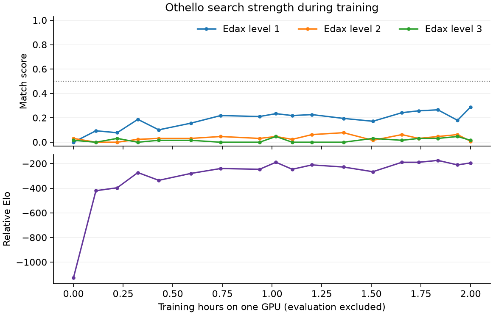

# mac-alpha-zero

**AlphaZero-style self-play training that runs end to end on your Mac.**

`mac-alpha-zero` is a game-agnostic library for batched Monte Carlo Tree Search and Gumbel AlphaZero–style training, built on [MLX](https://github.com/ml-explore/mlx) for Apple Silicon.

> **Status: alpha.** Self-play training runs end to end for Connect4 and Othello, and the Othello agent is measured against Edax as it trains. The API is not stable and there is no release yet. Milestones and every measurement so far are in [ROADMAP.md](ROADMAP.md).

## Quickstart

On an Apple Silicon Mac with [uv](https://docs.astral.sh/uv/):

```bash
git clone https://github.com/natsu0529/mac-alpha-zero.git
cd mac-alpha-zero
uv run python examples/train_connect4.py --minutes 10
```

This trains a Connect4 agent from scratch and prints, every few iterations, how it fares against a random player and against rollout MCTS, with and without search.

For Othello, build [Edax](https://github.com/abulmo/edax-reversi) once so the agent is scored against it while training:

```bash
scripts/build_edax.sh
uv run python examples/train_othello.py --minutes 60
uv run python examples/train_othello.py --minutes 60 --resume   # continue the same run
```

Weights, the replay buffer and a score log go to `checkpoints/`.

## Results so far

Apple M5, 24 GB, MLX 0.32.4. One run and one seed each; details and caveats in [ROADMAP.md](ROADMAP.md).

**Search speed with a network** (Connect4, 64-channel 4-block ResNet at every leaf, 64 simulations), simulations per second:

| Batch | mac-alpha-zero (MLX + Metal kernels) | [mctx](https://github.com/google-deepmind/mctx) (JAX, CPU) | Speedup |
|---:|---:|---:|---:|
| 1 | 1,167 | 6,353 | 0.18× |
| 64 | 51,781 | 17,999 | 2.9× |
| 256 | 70,485 | 18,899 | 3.7× |
| 1,024 | 62,789 | 13,621 | 4.6× |

**Othello trained from zero for 2 hours, against Edax 4.6** (100 games per cell, score where win = 1 and draw = 0.5):

| Agent | Edax level 1 | Edax level 2 |
|---|---:|---:|
| Random | 0.02 | 0.00 |
| Network, policy only | 0.17 | 0.01 |
| Network + Gumbel search, 128 sims | 0.29 | 0.10 |
| Network + Gumbel search, 512 sims | 0.41 | 0.07 |



The curve uses 32 search simulations and 64 games per opponent at each evaluation. Edax level 1 is the zero point for Elo. To regenerate it from the [original scores](benchmarks/data/othello/first-2h.log.jsonl):

```sh
uv run python benchmarks/checkpoint_elo.py benchmarks/data/othello/first-2h.log.jsonl > /tmp/othello-elo.jsonl
uv run --group media python benchmarks/plot_strength.py benchmarks/data/othello/first-2h.log.jsonl docs/othello-strength.png --ratings /tmp/othello-elo.jsonl
```

The loop learns, but two hours do not yet reach Edax level 1, and strength stops improving after about an hour with the current settings. Getting past level 1 is the next milestone.

## Why

- **There is no MCTS / AlphaZero library for MLX.** [mctx](https://github.com/google-deepmind/mctx) is excellent but built on JAX, whose Mac GPU support is experimental. PyTorch-based frameworks aren't tuned for Apple Silicon.
- **Unified memory changes the trade-offs.** On a Mac, game rules, tree search, and network inference share one memory pool. Work that suits the CPU (like chess move generation) can feed the GPU without copies.
- **Compute efficiency is the interesting question.** We don't try to out-muscle Lc0 or KataGo. We measure how much playing strength each GPU-hour on a single Mac buys, and push that number up.

## Features

Working now:

- Batched MCTS with fixed-shape tree arrays: thousands of games searched in parallel.
- PUCT and Gumbel root selection (strong policy improvement at low simulation counts).
- Fused Metal kernels for tree descent and backup.
- Self-play, replay buffer, training loop with resume, and arena matches against fixed opponents (random, rollout MCTS, Edax).
- Anchored Elo ratings from Othello evaluation logs and optional matches between saved checkpoints.
- A small environment interface: bring your own game by supplying batched rules and an observation encoding.

Planned:

- Chess and 9×9 Go.
- A PyPI release.

## Games

The core is game-agnostic. Each game has its own rules, network config, and trained weights.

| Game | Approach | Status |
|---|---|---|
| Connect4 | Internal test environment, checked against a solver | Trains end to end |
| Othello | Trained from scratch, evaluated against Edax | Trains end to end; below Edax level 1 so far |
| Chess | Pretrained on public data, fine-tuned by self-play | v0.2 |
| 9×9 Go | Trained by self-play, evaluated against GNU Go / KataGo | v0.3 |

## Requirements

- Apple Silicon Mac (developed on an M5 with 24 GB)
- macOS with Python 3.10+ and MLX 0.32.4+ (`uv` installs both)

## Contributing

See [CONTRIBUTING.md](CONTRIBUTING.md) for setup, tests, and benchmarks. Issues and discussion about the API and the roadmap are welcome. Ideas for getting the Othello agent past Edax level 1 are especially welcome; the open suspects are listed in [ROADMAP.md](ROADMAP.md).

## License

[MIT](LICENSE) — do whatever you want, just keep the notice.
