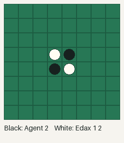
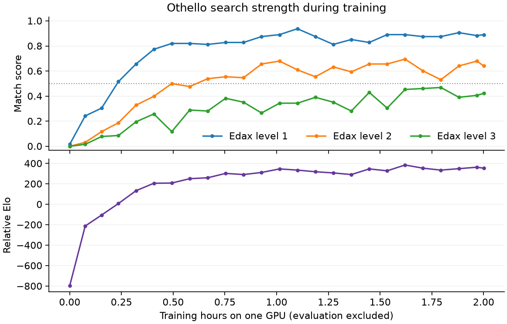

# mac-alpha-zero

**AlphaZero-style self-play training that runs end to end on your Mac.**

`mac-alpha-zero` is a game-agnostic library for batched Monte Carlo Tree Search and Gumbel AlphaZero–style training, built on [MLX](https://github.com/ml-explore/mlx) for Apple Silicon.



After two hours of self-play on an M5, the agent (black) beat Edax level 1 **36–28** in this game. After six random opening moves, the agent used 32 search simulations per move. [Game record](benchmarks/data/othello/edax-level1-game.json) · [100-game results](#results-so-far)

> **Status: alpha.** Self-play training runs end to end for Connect4 and Othello, and the Othello agent is measured against Edax as it trains. [v0.1.0](https://github.com/natsu0529/mac-alpha-zero/releases/tag/v0.1.0) includes the pretrained Othello weights. [Play the agent in your terminal](#play-the-pretrained-othello-agent). The API is still evolving. Milestones and every measurement so far are in [ROADMAP.md](ROADMAP.md).

## Install the Python library

On an Apple Silicon Mac, install [mac-alpha-zero from PyPI](https://pypi.org/project/mac-alpha-zero/) in your project's Python environment.

```sh
python -m pip install mac-alpha-zero
```

With uv, run `uv add mac-alpha-zero`. Import the package as `mac_alpha_zero`:

```python
from mac_alpha_zero import games

game = games.Othello()
```

## Quickstart

On an Apple Silicon Mac with [uv](https://docs.astral.sh/uv/):

```bash
git clone https://github.com/natsu0529/mac-alpha-zero.git
cd mac-alpha-zero
uv run python examples/train_connect4.py --minutes 10
```

This trains a Connect4 agent from scratch and prints, every few iterations, how it fares against a random player and against rollout MCTS, with and without search.

For Othello, build [Edax](https://github.com/abulmo/edax-reversi) once so the agent is scored against it while training:

```bash
scripts/build_edax.sh
uv run python examples/train_othello.py --minutes 60
uv run python examples/train_othello.py --minutes 60 --resume   # continue the same run
```

Weights, the replay buffer and a score log go to `checkpoints/`.

<a id="play-a-saved-othello-agent"></a>

### Play the pretrained Othello agent

To play the agent from the GIF on an Apple Silicon Mac, run these commands from the cloned repository. The download is 1.25 MB. You can start playing immediately with just the weights and [uv](https://docs.astral.sh/uv/).

```sh
mkdir -p checkpoints/v0.1.0
curl -fL https://github.com/natsu0529/mac-alpha-zero/releases/download/v0.1.0/othello.safetensors -o checkpoints/v0.1.0/othello.safetensors &&
  echo '7f9d0a671fccd67ba6ac7b29b5719a91b1d27cea216449919efcb04138f66bb6  checkpoints/v0.1.0/othello.safetensors' | shasum -a 256 -c - &&
  uv run python examples/play_othello.py checkpoints/v0.1.0/othello.safetensors
```

You play black (`X`). Enter a listed square such as `d3`, or `q` to quit. Pass `--color white` to let the agent open. To play your own trained agent, substitute the checkpoint path from the quickstart. Both the play and benchmark commands accept `--channels` and `--blocks` for custom network shapes.

To reproduce the published match against Edax 4.6 level 1, build Edax and run:

```sh
scripts/build_edax.sh
uv run python benchmarks/edax_match.py --checkpoint checkpoints/v0.1.0/othello.safetensors --search-only --levels 1 --games 100 --seed 0 --opening-plies 6 --simulations 32
```

With 50 openings played once per color, the agent scored **0.905** (90 wins, one draw, nine losses). It uses a 4-block, 64-channel network and PUCT below the Gumbel root.

## Results so far

Apple M5, 24 GB, MLX 0.32.4. One run and one seed each; details and caveats in [ROADMAP.md](ROADMAP.md).

**Search speed with a network** (Connect4, 64-channel 4-block ResNet at every leaf, 64 simulations), simulations per second:

| Batch | mac-alpha-zero (MLX + Metal kernels) | [mctx](https://github.com/google-deepmind/mctx) (JAX, CPU) | Speedup |
|---:|---:|---:|---:|
| 1 | 1,167 | 6,353 | 0.18× |
| 64 | 51,781 | 17,999 | 2.9× |
| 256 | 70,485 | 18,899 | 3.7× |
| 1,024 | 62,789 | 13,621 | 4.6× |

**Othello after two hours of training from scratch.** With board-symmetry augmentation and 32 search simulations per move, the agent won 90 games, drew one and lost nine against Edax 4.6 level 1. Each cell below is the score over 100 games from 50 six-ply openings played once per color. A draw counts as half a point.

| Agent | Edax level 1 | Edax level 2 |
|---|---:|---:|
| Random | 0.020 | 0.000 |
| Network, policy only | 0.715 | 0.270 |
| Network + Gumbel search, 32 sims | 0.905 | 0.605 |
| Network + Gumbel search, 128 sims | 0.990 | 0.820 |
| Network + Gumbel search, 512 sims | 1.000 | 0.960 |



The curve uses 64 games per opponent and 32 simulations per move at each evaluation. Elo is fitted to those results with Edax level 1 fixed at zero. The horizontal axis counts self-play and optimization. Including evaluation and checkpoint writes, training took 2 h 29 min. The training process peaked at **1.692 GiB** on the 24 GB M5.

After building Edax as shown in the quickstart, reproduce the training run and final matches with:

```sh
uv run python examples/train_othello.py --minutes 120 --symmetries --seed 0 --save-eval-weights --checkpoint checkpoints/sym.safetensors
uv run python benchmarks/edax_match.py --checkpoint checkpoints/sym.safetensors --games 100 --seed 0 --opening-plies 6 --levels 1 2 --simulations 32 128 512
```

Regenerate the figure from the [evaluation log](benchmarks/data/othello/sym-2h.log.jsonl):

```sh
uv run python benchmarks/checkpoint_elo.py benchmarks/data/othello/sym-2h.log.jsonl > /tmp/othello-elo.jsonl
uv run --group media python benchmarks/plot_strength.py benchmarks/data/othello/sym-2h.log.jsonl docs/othello-sym-strength.png --ratings /tmp/othello-elo.jsonl
```

The [full comparison](ROADMAP.md#two-hour-othello-comparison) includes the [first run without symmetry augmentation](docs/othello-strength.png) and a second symmetry-augmented run with a decaying learning rate.

## Why

- **There is no MCTS / AlphaZero library for MLX.** [mctx](https://github.com/google-deepmind/mctx) is excellent but built on JAX, whose Mac GPU support is experimental. PyTorch-based frameworks aren't tuned for Apple Silicon.
- **Unified memory changes the trade-offs.** On a Mac, game rules, tree search, and network inference share one memory pool. Work that suits the CPU (like chess move generation) can feed the GPU without copies.
- **Compute efficiency is the interesting question.** We don't try to out-muscle Lc0 or KataGo. We measure how much playing strength each GPU-hour on a single Mac buys, and push that number up.

## Features

Working now:

- Batched MCTS with fixed-shape tree arrays: thousands of games searched in parallel.
- PUCT and Gumbel root selection (strong policy improvement at low simulation counts).
- Fused Metal kernels for tree descent and backup.
- Self-play, replay buffer, training loop with resume, and arena matches against fixed opponents (random, rollout MCTS, Edax).
- Anchored Elo ratings from Othello evaluation logs and optional matches between saved checkpoints.
- A small environment interface: bring your own game by supplying batched rules and an observation encoding.

Planned:

- Chess and 9×9 Go.

## Games

The core is game-agnostic. Each game has its own rules, network config, and trained weights.

| Game | Approach | Status |
|---|---|---|
| Connect4 | Internal test environment, checked against a solver | Trains end to end |
| Othello | Trained from scratch, evaluated against Edax | Scored 0.905 against Edax level 1 at 32 simulations per move |
| Chess | Pretrained on public data, fine-tuned by self-play | v0.2 |
| 9×9 Go | Trained by self-play, evaluated against GNU Go / KataGo | v0.3 |

## Requirements

- Apple Silicon Mac (developed on an M5 with 24 GB)
- macOS with Python 3.10+ and MLX 0.32.4+ (`uv` installs both)

Both 10-minute quickstarts completed and saved weights on the **M5 with 24 GB** (macOS 26.6.2, MLX 0.32.4, Metal kernels enabled, Edax installed). Elapsed time includes evaluation and saving. Self-play throughput counts time generating samples. Peak memory is the Python process footprint reported by macOS over the full command.

| Quickstart | Elapsed (min:sec) | Self-play games/s | Peak memory footprint |
|---|---:|---:|---:|
| Connect4 | 37:28 | 59.51 | 1,379,435,552 bytes (1.285 GiB) |
| Othello | 14:55 | 17.52 | 1,813,103,552 bytes (1.689 GiB) |

The minimum supported memory is still unverified. Help document support for other Macs by [reporting a quickstart result](CONTRIBUTING.md#report-an-apple-silicon-quickstart).

## Contributing

See [CONTRIBUTING.md](CONTRIBUTING.md) for setup, tests, and benchmarks. Issues and discussion about the API and the roadmap are welcome.

## License

[MIT](LICENSE) — do whatever you want, just keep the notice.
